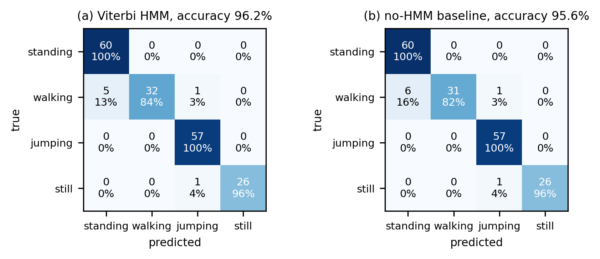
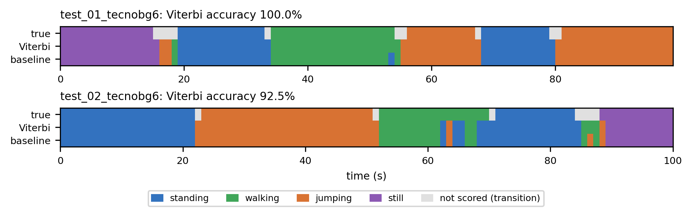
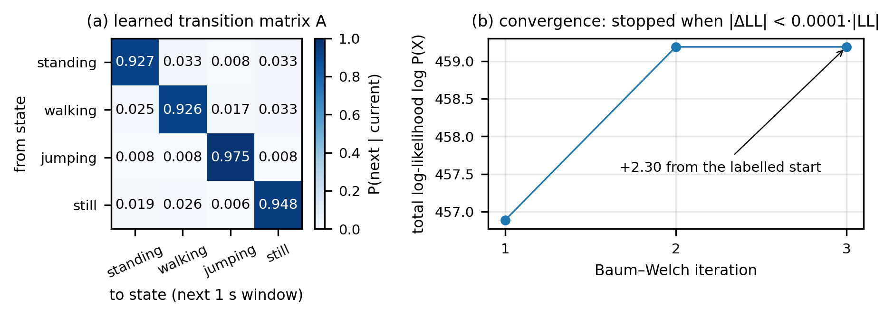

# Human Activity Recognition with a Hidden Markov Model Built from Scratch

> A waist-worn phone that tells a carer whether someone is standing, walking, moving vigorously, or not wearing the phone at all.

**Author:** Elvin Cyubahiro · Formative 2: Hidden Markov Models

## Results at a glance

| Metric (182 windows from 2 unseen recordings) | Viterbi HMM | No-HMM baseline |
|---|---|---|
| Overall accuracy | **96.2 %** | 95.6 % |

| State | Samples | Sensitivity | Specificity |
|---|---|---|---|
| Standing | 60 | 1.000 | 0.959 |
| Walking | 38 | 0.842 | 1.000 |
| Jumping | 57 | 1.000 | 0.984 |
| Still | 27 | 0.963 | 1.000 |

- **test_01** (same evening as training, recorded after every training clip): **100 %**
- **test_02** (three days later, different room): **92.5 %**. Its first decoding failed on still and prompted the tilt features and five extra still clips, so only test_01 is strictly blind.
- Windows that straddle an activity change are not scored (17 of 199).







## Dataset

- **65** cleaned training clips (8–10 s each): standing 15, walking 15, jumping 15, still 20; every activity 140–184 s
- **2** unseen continuous test recordings (100 s and 101 s) from separate sessions, each containing all four activities
- Sensors: accelerometer, gyroscope and gravity (x, y, z), harmonised to **50 Hz**

| Device | Used for | App | Measured accel Hz | Measured gyro Hz |
|---|---|---|---|---|
| TECNO BG6 (Android 13) | training + test | Sensor Logger 1.68 | 98.7 | 98.7 |

Rates are measured as `1 / median(diff(timestamps))`, not taken from the app setting.

**Naming:** `data/train/<activity>/<activity>_<device>_<NN>.csv`, `data/test/test_<NN>_<device>.csv`
**Columns:** `timestamp` (s from start), `acc_x..z` (m/s², gravity removed), `gyro_x..z` (rad/s), `grav_x..z` (m/s²), `label`, `device`

## Data-collection videos

All four clips (standing, walking, jumping, still) are in one shared folder: [Google Drive](https://drive.google.com/drive/folders/1At2rjn7tY4XtR3fr50MYekNMxAWrPHvw?usp=sharing)

## Reproduce

```bash
pip install -r requirements.txt
python -m src.preprocessing            # raw Sensor Logger zips -> cleaned CSVs
python scripts/validate_dataset.py     # dataset meets rubric targets
python -m pytest tests/ -q             # HMM verified against brute-force enumeration
jupyter notebook notebooks/HMM_Activity_Recognition.ipynb   # Kernel → Restart & Run All
```

## Structure

```
data/raw/train/    original Sensor Logger exports, one folder per activity
data/raw/test/     original test exports + hand-annotated segment CSVs
data/train/        cleaned, labelled training CSVs (one folder per activity)
data/test/         cleaned, labelled continuous test recordings
notebooks/         HMM_Activity_Recognition.ipynb (end-to-end pipeline)
src/               preprocessing.py · features.py · hmm.py (numpy, from scratch)
tests/             test_hmm_sanity.py
scripts/           validate_dataset.py
reports/figures/   all figures used in the report
```

## Method

Sensors are merged onto one clock, low-pass filtered and resampled to 50 Hz, then cut into 2 s windows (100 samples, 50 % overlap, 0.5 Hz FFT resolution) → 15 time-domain, orientation and FFT features → Z-score fitted on training windows only → 4-state diagonal-Gaussian HMM initialised from labels, refined by Baum–Welch until the relative log-likelihood change is < 1e-4 (3 iterations), decoded with Viterbi.
