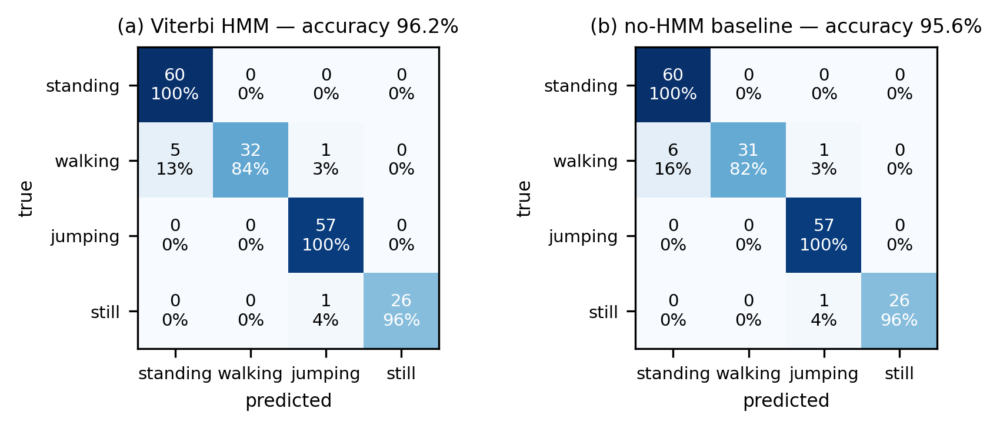

# {{PROJECT_TITLE}} — Human Activity Recognition with a From-Scratch Hidden Markov Model

> {{USE_CASE_ONE_LINER}}

**Author:** {{YOUR_NAME}} · Formative 2 – Hidden Markov Models

## Results at a glance

| Metric (unseen test data) | Viterbi HMM | No-HMM baseline |
|---|---|---|
| Overall accuracy | {{OVERALL_ACC}} | {{OVERALL_ACC_NO_HMM}} |



## Dataset

- **{{N_TRAIN_FILES}}** cleaned training recordings (5–10 s each) across 4 activities: standing, walking, jumping, still
- **{{N_TEST_FILES}}** unseen continuous test recordings ({{TEST_SOURCE}})
- Sensors: accelerometer (x, y, z) + gyroscope (x, y, z), harmonized to **50 Hz**

| Device | Used for | App | Measured accel Hz | Measured gyro Hz |
|---|---|---|---|---|
| {{PHONE}} | training + test | {{APP}} | {{FS_ACC}} | {{FS_GYR}} |

Rates are measured as `1 / median(diff(timestamps))` by `scripts/validate_dataset.py`, not taken from the app setting.

**Naming:** `data/train/<activity>/<activity>_<name>_<NN>.csv`, `data/test/test_<NN>_<name>.csv`
**Columns:** `timestamp` (s from start), `acc_x`, `acc_y`, `acc_z`, `gyro_x`, `gyro_y`, `gyro_z`, `label`, `device`

## Data-collection videos

| Activity | Link |
|---|---|
| Standing | {{VIDEO_LINK_STANDING}} |
| Walking | {{VIDEO_LINK_WALKING}} |
| Jumping | {{VIDEO_LINK_JUMPING}} |
| Still | {{VIDEO_LINK_STILL}} |

## Reproduce

```bash
pip install -r requirements.txt
python scripts/validate_dataset.py     # dataset meets rubric targets
python -m pytest tests/ -q             # HMM verified against brute-force enumeration
jupyter notebook notebooks/HMM_Activity_Recognition.ipynb   # Kernel → Restart & Run All
```

## Structure

```
data/raw/          original app exports (traceability)
data/train/        cleaned, labelled training CSVs (one folder per activity)
data/test/         unseen continuous test recordings + segment annotations
notebooks/         HMM_Activity_Recognition.ipynb (end-to-end pipeline)
src/               preprocessing.py · features.py · hmm.py (numpy, from scratch)
tests/             test_hmm_sanity.py (forward/Viterbi vs brute force, Baum–Welch monotonic)
scripts/           validate_dataset.py
reports/figures/   all figures used in the report
```

## Method in one paragraph

Accelerometer and gyroscope streams are merged onto one clock and resampled to a uniform 50 Hz grid, then cut into 2 s windows (100 samples, 50 % overlap) → {{N_FEATURES}} time- and FFT-domain features → Z-score (training windows only) → 4-state diagonal-Gaussian HMM initialised from labels, refined by Baum–Welch until the relative change in log-likelihood < 1e-4, decoded with Viterbi.
